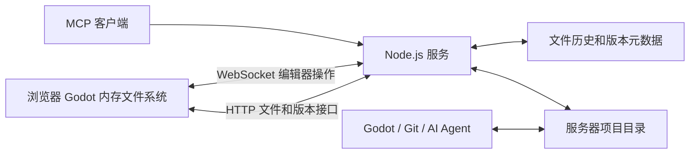

# 服务器文件存储架构

## 数据位置

`GWE_DATA_DIR/projects/<id>/files/` 保存每个项目的当前文件。`objects/<sha256>` 保存文件内容的历史副本。SQLite 中只保存项目名称、版本关系、文件清单、会话以及待完成写入记录。

## 保存和恢复

1. 浏览器通过插件获取当前文件的 SHA-256 清单。
2. 将上次读取的版本、编辑器当前文件、服务器当前文件进行比较。不同文件的修改可以合并，冲突文件要求用户选择。
3. 变化的文件以二进制 HTTP 请求上传。服务器校验文件内容并写入 `objects/`，上传完成后提交文件清单和 `baseRevision`。
4. 服务器检查当前版本、文件内容、路径和删除确认。检查通过后，在 SQLite 事务中记录新版本及待完成的目录写入。
5. 文件内容经过 `staging/` 临时文件、`fsync` 和原子重命名写入项目目录。删除操作只处理清单中明确删除的文件。完成后清除待完成记录，再向客户端确认成功。
6. 进程在写入期间终止时，下次启动继续完成待完成记录。如果发现目录中的同一个文件有额外修改，立即报告冲突。

单个文件替换是原子的，整个项目的多个文件会依次写入。直接读取项目目录的外部进程应避开保存过程；API 客户端按服务器返回的版本读取文件。外部工具与浏览器同时修改同一个文件时，应等待冲突处理，不能依赖无协调的并发写入。

服务器读取当前项目时扫描普通文件，检查与历史清单的差异。外部工具保存的修改会产生新版本。文件符号链接及项目外路径被拒绝。`.git/` 和 `.godot/` 不加入项目清单。

## 编辑器和游戏

`web/server.html` 和 `web/js/server-app.js` 是服务器版本入口。`ServerSync` 从服务器下载项目并调用 `Engine.copyToFS()`，Godot 使用空的 `persistentPaths`。浏览器关闭后，内存中的项目副本随页面释放。

`web_editor_bridge` 插件提供文件清单、读写、场景重新加载、编辑器状态及运行控制。运行游戏时，插件列出包括导入缓存在内的运行文件，父页面将内容发送给独立的游戏 iframe。停止游戏释放 iframe 及其运行资源。

共享的 `ProjectAPI` 提供浏览器 JavaScript、WebMCP 和编辑器控制操作。服务器模式的测试执行器直接读取内存中的配置，游戏运行前复制当前文件，流程不使用 IndexedDB。

## MCP 和登录

`server/mcp.js` 使用官方 MCP SDK 提供 Streamable HTTP。文件操作由 `ProjectStore` 直接执行；所有修改都检查 `base_revision`。编辑器专属操作通过一次性 WebSocket 连接票据发送到浏览器。

浏览器使用访问密钥登录，服务器只向页面签发 HttpOnly Cookie。会话摘要保存在 SQLite，MCP 客户端使用 Bearer 访问密钥。服务端检查请求 Origin 和 Cookie 写请求的 `X-GWE` 头。

当前服务管理一个共享工作区，访问密钥对全部项目有效。配置和文件备份由部署方负责。

## 主要模块

- `server/store.js`：普通文件、版本元数据、原子文件替换、目录变更检测、写入恢复。
- `server/projects.js`：项目初始化、官方插件安装、ZIP 导入导出。
- `server/app.js`：HTTP 文件接口、认证和静态资源。
- `server/mcp.js`、`server/connections.js`：MCP 和浏览器编辑器连接。
- `web/js/server-sync.js`：内存项目与服务器文件的版本同步。
- `web/js/server-app.js`：登录、项目选择、文件操作、保存状态、冲突和历史界面。
- `tests/server-storage.test.mjs`：实际服务器存储及 MCP 验证。
- `tests/e2e-server.mjs`：实际浏览器、Godot 和服务器验证。
